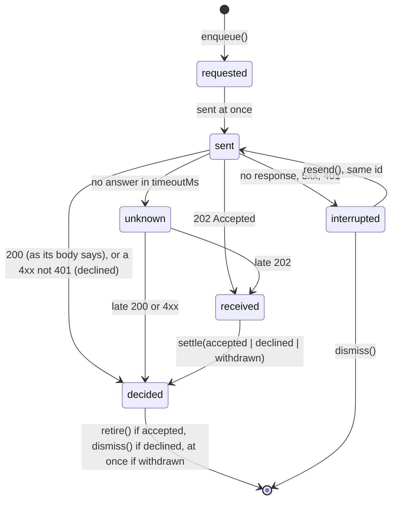
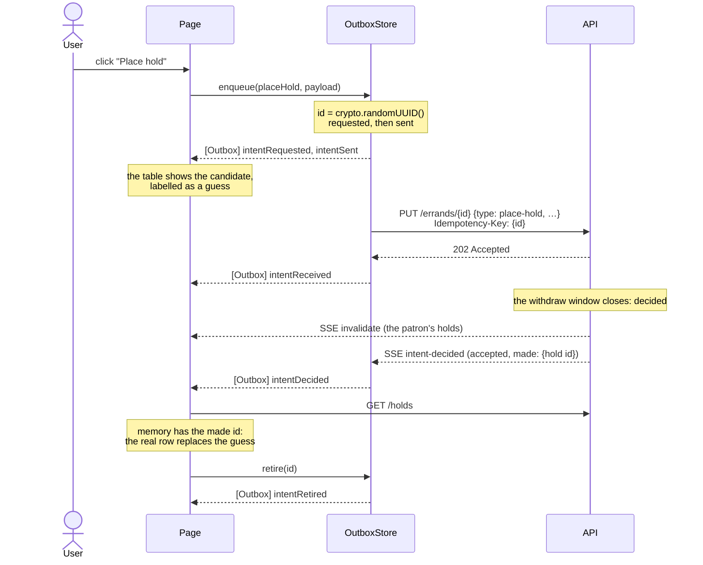

# outbox

A browser outbox for Angular: it holds what the user **asked for** (intents), sends
each one, and walks it through an honest lifecycle, so the screen can always say
something true. It owns the guesses, never the app's data.

Built on NgRx Signal Store (`@ngrx/signals`, entities, and events). Imported in this
workspace as `outbox`, through `tsconfig` paths to source. The wire protocol it speaks
is [docs/PROTOCOL.md](../../../../docs/PROTOCOL.md). This file is how to use it.

## The idea in four words

| Word          | Means                                                                         | In code                                             |
| ------------- | ----------------------------------------------------------------------------- | --------------------------------------------------- |
| **Intent**    | What the user asked for, as a message with its own id. A request, not a fact. | `Intent` (plain data)                               |
| **Receipt**   | What's true the moment it's asked: "We've received your request…"             | `receipt()` on the type; `store.receipts()`         |
| **Candidate** | A guess at what the intent will become, kept _apart_ from the server's data.  | `candidate()` on the type; `store.candidates(type)` |
| **Apology**   | What the user is told when the guess didn't hold, or might not have.          | `apology` on the type; `store.apologies()`          |

And one act: **promotion**. When the server's version arrives in the feature's own
data, the guess has done its job, and the feature **retires** the intent. Nothing
edits the server's data to "make it look right."

## Lifecycle



| State             | What's true                                                              | Receipt | Candidate          | Remedy       |
| ----------------- | ------------------------------------------------------------------------ | ------- | ------------------ | ------------ |
| `requested`       | It's held here. Nothing has left.                                        | yes     | yes                |              |
| `sent`            | It left. We don't know if it arrived.                                    | yes     | yes                |              |
| `unknown`         | No answer in time. It **may have landed**. Not a failure.                | yes     | yes                | wait         |
| `received`        | The server has it (202). The outcome is later. **Received is not done.** | yes     | yes                |              |
| `decided`         | Final. `outcome` says how: `accepted`, `declined`, or `withdrawn`.       | yes     | if accepted, until retired | no, if declined |
| `interrupted`     | Nothing was decided, nothing is in flight. It may have landed.           | yes     | yes                | try-again \* |

\* Or `sign-in`, for a `401`. Apologies are sorted by what the person can do next: see
PROTOCOL's Remedies.

**Withdrawn** means the person took it back before it was decided
(`DELETE /errands/{id}`). Nothing is owed, so the outbox lets it go as soon as it's
announced.

**A decision is final.** A `decided` intent never moves again, except out (retire,
dismiss). Answers can arrive in any order (the PUT's own answer, a status
check, a server event), and a late one must not undo what's known.

## How a hold moves through it

Against the reference server, with `provideOutboxStream`. Without the stream, a status
check (`GET /errands/{id}`) finds the outcome instead, and it ends the same way.



## Using it

### 1. Declare an intent type

Behavior lives on the type, registered in code. The intent itself is plain data.

```ts
import { defineIntentType } from 'outbox';

export const placeHold = defineIntentType<PlaceHoldPayload, Hold>({
  name: 'place-hold', // stored on every intent; keep it stable across deploys
  request: ({ id, payload }) => ({
    method: 'PUT',
    url: `${API_URL}/errands/${id}`, // the intent's id is the errand's id
    body: { type: 'place-hold', titleId: payload.titleId, branchCode: payload.branchCode },
  }),
  receipt: ({ payload }) => `We've received your request to place a hold on ${payload.titleName}.`,
  candidate: ({ id, payload }) => ({ id, titleId: payload.titleId, status: 'placed' }),
  apology: {
    say: ({ payload }, failure) =>
      failure.remedy === 'wait'
        ? `We're not sure your hold on ${payload.titleName} went through. We're still checking.`
        : `We couldn't place your hold on ${payload.titleName}: ${failure.detail ?? 'please try again.'}`,
    actions: ['retry'],
  },
  timeoutMs: 10_000, // default 30 s
});
```

**If you can't write the apology, you haven't earned the candidate.** `candidate` is
optional; `receipt` and `apology` are not.

### 2. Register it, app-wide

```ts
// app.config.ts
providers: [provideHttpClient(), provideIntentTypes(placeHold)];
```

In the application's providers, not a route's: an intent outlives the page that made
it. `enqueue` throws for an unregistered type.

### 3. Command in

```ts
const outbox = inject(OutboxStore);
outbox.enqueue(placeHold, { titleId, titleName, branchCode });
```

**The outbox sends every intent it's given.** Preventing a double submit is the
page's job, and a disabled button isn't enough (a second click can arrive before the
re-render). Check a signal in the handler:

```ts
protected place() {
  if (this.sending()) return; // computed over this page's intents: requested or sent
  this.outbox.enqueue(placeHold, { ... });
}
```

### 4. Events out

Every transition is a global event carrying the intent. The outbox doesn't know who
listens.

```ts
inject(Events)
  .on(outboxEvents.intentReceived, outboxEvents.intentDecided)
  .pipe(takeUntilDestroyed())
  .subscribe(() => this.myHolds.reload()); // the page decides what it means for its data
```

### 5. Hearing how it ended

A `received` intent waits for an outcome. Three rungs, each on top of the last, all
ending the same way:

1. **Ask** (PROTOCOL §2). Declare how on the intent type, then `outbox.checkStatus(id)`
   (a "Check status" button) or `outbox.checkWaiting()` (everything `received` or
   `unknown`):

   ```ts
   status: {
     url: (intent) => `/api/errands/${intent.id}`,
     outcome: (errand: Errand) =>
       errand.outcome === 'accepted' ? { outcome: 'accepted', made: errand.made ?? undefined }
       : errand.outcome === 'declined' ? { outcome: 'declined', detail: errand.reason ?? undefined }
       : errand.outcome === 'withdrawn' ? { outcome: 'withdrawn' }
       : undefined, // not decided yet
   },
   ```

   Every errand reads the same way, so one `status` serves every type. It also reads a
   `200` answer to the request itself: a repeat of a declined errand is a `200` too.

2. **Ask when the user comes back to the tab**: `provideOutboxStatusChecks()` in
   app.config. This is the floor: it works with no stream at all.
3. **Be told** (PROTOCOL §3): `provideOutboxStream({ eventsUrl, sessionUrl })` in
   app.config. It settles intents on `intent-decided`, runs `checkWaiting()` on every
   (re)connect, and announces `[Server] subscribed`, `invalidated { keys }`, and
   `signedOut` for anyone holding reads. When the stream drops, it asks the session
   before reconnecting (with backoff), and stops if you're signed out.

An outcome learned any other way goes in with `resolve(id, outcome)`.

### 6. Show memory and guesses together, then promote

```ts
protected readonly rows = computed(() =>
  mergeWithCandidates(this.myHolds.value(), this.outbox.candidates(placeHold), (h) => h.id),
);
```

Candidates come first and drop out the moment memory has their id, so the guess and
the real row never both show. A candidate's id is the intent's, or, once the outcome
says what it `made`, that id. `isCandidate(row)` tells them apart in a template.

```ts
effect(() => {
  const accepted = this.myIntents().filter(
    (i) => i.state.status === 'decided' && i.state.outcome === 'accepted',
  );
  const ready = readyToRetire(accepted, this.myHolds.value(), (h) => h.id);
  untracked(() => ready.forEach((id) => this.outbox.retire(id)));
});
```

### 7. Cached reads, and saying what's stale

```ts
// app.config
provideHttpClient(withFetch()),
provideReads({ apiRoot: '/api' }),

// a component
protected readonly myHolds = cachedHttpResource<Hold[]>(() => `/holds?patronId=${this.patronId()}`);
```

A real Angular `Resource` (`value`, `status`, `isLoading`, `hasValue`), plus `fetchedAt`,
`stale`, `refreshError`, and `reload()`. Every reader of a key shares one entry and one
request.

- **Memory only.** It holds what the server answered, never candidates. Merge those in
  for display (step 6).
- **Fresh only while live.** A value fetched while the event stream is connected stays
  fresh until an invalidation covers it. Without a stream (or after it drops), values
  are stale-first: shown with their `fetchedAt`, and refetched when someone reads them.
- **Invalidated from either side.** The server's `invalidate`, or an intent type's own
  declaration, announced when the server has recorded the intent (received, or
  decided, though a decision against only after being received), for this tab, at once:

  ```ts
  invalidates: ({ payload }) => [`/holds?patronId=${payload.patronId}`],
  ```

  Both arrive as `invalidationEvents.invalidated { keys, from }`, matched with PROTOCOL
  §3's rule (`covers`).

- **A failed refetch keeps the value** (it's still the last thing the server said) and
  sets `refreshError`. Only a first load that fails is `error`.
- Refetches send `cache: 'no-cache'`, so they reach the server (a cheap 304 with an ETag)
  rather than the browser's HTTP cache. That needs `withFetch()`.

### 8. Surviving a reload

```ts
provideIntentStorage({
  sessionUrl: '/api/session',
  userOf: (session: { patronId: string | null }) => session.patronId ?? undefined,
}),
```

It asks the session who's signed in and stamps every intent with that id. Each intent is
stored (IndexedDB) **before** it's sent, so a tab closed mid-send still leaves something
to ask about. On startup it puts back only that user's intents and status-checks the
ones still waiting. One that was `sent` comes back `unknown`: nothing from the old page is
in flight any more. It never resends. Until the session answers, or while signed out,
intents are sent but not stored. For tests, pass `storage: memoryIntentStorage()`.

## Reference

### `OutboxStore` (root signal store)

| Member                      | What it does                                                                                       |
| --------------------------- | -------------------------------------------------------------------------------------------------- |
| `enqueue(type, payload)`    | Creates the intent (new id), publishes `intentRequested`, sends it. Returns the intent.            |
| `resolve(id, outcome)`      | Records an outcome learned some other way. Ignored for unknown ids and decided intents.            |
| `settle(id, outcome)`       | The same, as the stream says it: `accepted` (with what it `made`), `declined` (with a `detail`), or `withdrawn`. |
| `checkStatus(id)`           | Asks the type's `status.url`; settles if the answer is decided. A 404 is "not recorded yet".       |
| `checkWaiting()`            | `checkStatus` for every `received`, `unknown`, and `interrupted` intent.                           |
| `resend(id)`                | Sends an `interrupted` intent again, same id. Anything else is ignored.                            |
| `resendInterrupted()`       | `resend` for every interrupted intent asked on this page (not restored ones). The stream calls it. |
| `retire(id)`                | Promotion: removes the intent, publishes `intentRetired`.                                          |
| `dismiss(id)`               | The user let it go: removes the intent, publishes `intentDismissed`.                               |
| `entities()`, `entityMap()` | Every intent still held (from `withEntities`).                                                     |
| `receipts()`                | `{ intentId, status, text }` for every intent held. Always true.                                   |
| `apologies()`               | `{ intentId, status, remedy, message, actions }` for `unknown`, declined, `interrupted`.          |
| `candidates(type)`          | `Candidate<T>[]` for that type, except ones decided against.                                       |

### Sending

- One `HttpClient.request` per intent, with `Idempotency-Key: {intent.id}` and the
  type's method, url, and body. (Only `POST`, `PUT`, `PATCH`, `DELETE`.)
- **202** → `received`. **Any other 2xx** → `decided`, as its body says, read by the
  type's `status.outcome` (a repeat of a declined errand is a `200`). With no body, or no
  `status`, accepted.
- **No response, a `5xx`, or a `401`** → `interrupted`: nothing was decided. Remedy
  `try-again` (or `sign-in` for the `401`). It goes again with the **same** id.
- **Any other error** → `decided`, declined, remedy `no`, with the HTTP status and a
  problem+json `detail` if the body has one.
- **No answer in `timeoutMs`** → `unknown`. The request is **not** cancelled: a late
  answer still lands, unless the intent was decided some other way meanwhile.

### Events (`outboxEvents`, source `Outbox`)

`[Outbox] intentRequested`, `intentSent`, `intentReceived`, `intentDecided`,
`intentUnknown`, `intentInterrupted`, `intentRetired`, `intentDismissed`. Each carries
`{ intent }`; for `intentDecided`, `intent.state.outcome` says how it ended.

### Promotion helpers

- `mergeWithCandidates(memory, candidates, idOf)`: memory plus the candidates not yet
  in it, candidates first. Never edits memory.
- `readyToRetire(done, memory, idOf)`: the ids of the decided intents whose real item
  memory now contains.
- `realIdOf(intent)`: the id the real item has, or will have: what the outcome `made`,
  or else the intent's own.
- `isCandidate(item)`: narrows `T | Candidate<T>`.

### Types

`Intent`, `IntentState`, `IntentStatus`, `Failure`, `Candidate`, `IntentType`,
`IntentRequest`, `Apology`, `ApologyAction`, `Outcome`, `StatusCheck`, `Receipt`,
`ApologyNotice`, `defineIntentType`, `provideIntentTypes`. See `src/lib/types.ts`.

### The stream (`src/lib/stream.ts`)

`provideOutboxStream(options)`, `provideOutboxStatusChecks()`, `serverEvents` (source
`Server`: `subscribed`, `disconnected`, `signedOut`), `invalidationEvents` (source
`Reads`: `invalidated { keys, from }`), and `EVENT_SOURCE` (the EventSource factory, to
replace in tests).

### Reads (`src/lib/reads.ts`, `src/lib/read-cache.ts`)

`provideReads({ apiRoot })`, `cachedHttpResource(key)`, `Reads` (the app's cache), and
`ReadCache`, the same cache with no framework (`watch`, `refresh`, `invalidate`,
`setLive`). `covers(key, readKey)` is the matching rule.

## Rules the library keeps

- **Intents are plain, serializable data.** No functions, classes, or `Date`s
  (timestamps are epoch ms), and a `schema` version, so a later phase can store them.
- **Behavior is registered, never stored.** A stored intent names its type.
- **The intent's id is the idempotency key, and the real item's id** unless the outcome
  says what it `made`. Either way, "has the server's version arrived?" is an exact check.
- **It never writes the app's data.** Features read their data from their own
  resources, and guesses from here.
- **A decision is final.**

## Not yet

Not built:

- **The rest of durability.** Stored intents are only status-checked, never resent
  (even on a `404`). No time limit on old requests, no one-tab-at-a-time, no clearing on
  sign-out. And a stored intent that was decided while you were away just appears in
  memory: nobody tells you "your hold went through".
- **Retry.** An apology's `actions` are declared, but nothing performs them. A retry
  after a decision will be a _new_ intent; reusing the id is only for an outcome
  never known.
- **Ordering between intents.** Every intent is sent at once (`mergeMap`). Per-type
  `concatMap` is a proposal in the design.
- **Stale intents** (`staleAfter`): re-confirming an intent that waited too long.
- **Polling on a timer.** It asks when told to, when the tab becomes visible, and on
  every stream (re)connect. It never asks on an interval.

## Tests

```bash
npx ng test outbox --watch=false
```
