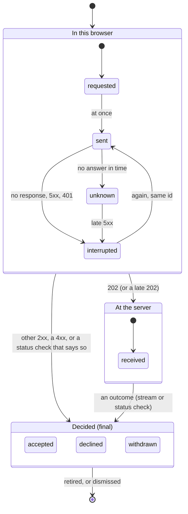
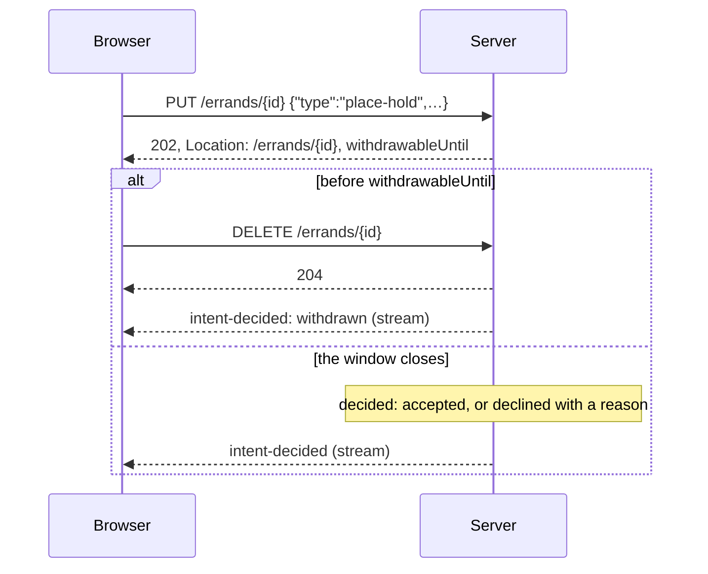

# Intent wire protocol

**Draft 0.4, 2026-10-26.** How a browser and an API agree about who's asking, about
commands the user asked for, and about reads that have gone stale. Framework-neutral:
this page is the contract; the Angular `outbox` library and the Wolverine/Fisher backend
in this repo are one implementation of each side.

If you're building a client for this protocol (in any framework), read
[The client](#the-client) and [Conformance scenarios](#conformance-scenarios). If you're
building a server, read [The server](#the-server). Everyone reads [Vocabulary](#vocabulary).

**Everything here is built**: the reference server and the Angular client do it today.
Ideas that aren't built live in [`unsettled/`](../unsettled), until they are or until they're dropped.

---

## Vocabulary

| Term             | Means                                                                                                                  |
| ---------------- | ---------------------------------------------------------------------------------------------------------------------- |
| **Intent**       | Something the user asked the server to do, with a client-generated id. A request, not a fact.                          |
| **Intent id**    | A UUID the client makes (`crypto.randomUUID()`). It is the idempotency key. For a create, it's also the new resource's id. |
| **Outcome**      | How an intent ended: `accepted`, `declined`, or `withdrawn` (the person took it back first). **An outcome is final.**  |
| **Memory**       | The server's data, as the client last fetched it. The client never edits it to "look right."                           |
| **Receipt**      | What the client can truthfully say about an intent right now ("We've received your request…"). Always true.            |
| **Candidate**    | The client's guess at what an intent will become. Kept apart from memory and dropped when memory has the real item.    |
| **Apology**      | What the client tells the person when a guess didn't hold, or might not have. Written in advance, per intent type.      |
| **Remedy**       | What the person can do about an apology: `try-again`, `wait`, `no`, `sign-in`. See [Remedies](#remedies).            |
| **Read key**     | The path (and query) of a GET, relative to the API root, e.g. `/holds?patronId=p1`. Identifies a cached read.          |
| **Errand**       | An intent addressed to `/errands` rather than to the resource it changes: what the server takes on for the person, knowing the answer may be no. See [§5](#5-errands). |

---

## Intent lifecycle

The states a client keeps for each intent. The wire carries only what the server knows;
these states are how a client turns that into something true to say. Remedies,
durability, and the conformance scenarios are all written in terms of them.



| State             | What's true                                                     | Candidate          | Apology's remedy |
| ----------------- | --------------------------------------------------------------- | ------------------ | ---------------- |
| `requested`       | It's held here. Nothing has left.                               | yes                |                  |
| `sent`            | It left. We don't know if it arrived.                           | yes                |                  |
| `unknown`         | No answer in time. It **may have landed**. Not a failure.       | yes                | `wait`           |
| `received`        | The server has it (`202`). **Received is not done.**            | yes                |                  |
| `decided`         | Final. Its outcome says how: `accepted`, `declined`, `withdrawn`. | if accepted, until retired | `no`, if declined |
| `interrupted`     | Nothing was decided and nothing is in flight. It may have landed. | yes                | `try-again`, or `sign-in` (a `401`) |

Every state has a receipt.

- **A decision is final.** A `decided` intent never changes again; it only leaves
  (retired once memory has it, dismissed after its apology, or at once if withdrawn). Answers arrive in any order, and
  a late one must not undo what's known.
- **Only a decision is final.** A `5xx`, a `401`, or no response isn't a decision, so it
  lands in `interrupted`, which goes again with the **same id**. A new id would be a new
  request, and a duplicate if the first one landed after the server committed.
- **Withdrawn** means the person took it back before it was decided. After the request
  has left this browser, that takes a new intent (a cancel), which races the decision. If
  the cancel gets there first, the first intent's outcome is `withdrawn`, and nothing is
  owed: no receipt, guess, or apology. If the decision gets there first, the first intent
  is decided as usual, and the cancel acts on whatever it became.

---

## 0. Identity

Who the user is never travels in a URL or a payload the client composes. The reference
server does all of this, with a Development-only cookie sign-in standing in for a real
identity provider.

- **The browser sends the credentials on its own:** a session cookie, `HttpOnly`,
  `SameSite=Strict`. (`EventSource` can't send an `Authorization` header anyway.) Who
  issues the cookie (an edge that keeps the user's tokens server-side, usually) is outside
  this protocol.
- **Unauthenticated means `401`, never a redirect.** A `fetch` or an `EventSource` can't
  follow a login page.
- **There is a session resource** the client can ask "am I signed in?" (the reference uses
  `GET /session`, always `200`, with the answer in the body). `EventSource` can't tell a
  `401` from a server that went away, so when the stream drops, a client asks this
  before reconnecting, and stops reconnecting if it's signed out.
- When signed in, the session's answer also says **who**: an id for the user that stays
  the same across sessions (the reference: `patronId`). A client that stores intents
  stamps each one with it ([Durability](#durability)). It's only
  a label for sorting stored intents; the server never trusts it from the client.
- **Unsafe requests without an `Idempotency-Key` are rejected** (`400`, problem+json).
  §1 already requires the header. Enforcing it also makes it a CSRF defence: a custom
  header can't cross origins without a preflight. With `SameSite=Strict`, that's all of
  it, with no antiforgery token. (Reasoned, not yet reviewed by a security person.)

---

## 1. Commands

### Request

A command is an HTTP `PUT`, `POST`, `PATCH`, or `DELETE`, sent with the intent id as its
idempotency key:

```http
PUT /holds/0b6e0c3e-6a5c-4c4e-9f6e-2f0d8f1c7a11 HTTP/1.1
Idempotency-Key: 0b6e0c3e-6a5c-4c4e-9f6e-2f0d8f1c7a11
Content-Type: application/json

{ "titleId": 42, "branchCode": "MAIN" }
```

- The client **MUST** send `Idempotency-Key: {intent id}` on every command.
- A command acts for the session's user (§0). The body never says who; the server
  answers `401` without a session.
- When a command creates something, **prefer `PUT` to the resource's own URL with the
  intent id as its id.** Then "has the server's version arrived?" is an exact check: memory
  contains an item with that id. (`POST` with an `Idempotency-Key` is allowed when the
  server must choose the URL, but the client loses that exact check.)
- The client **MAY** send the same command again with the same id at any time (after a
  timeout, after a reload). That must always be safe.

### Response

| Status                        | Means                                                                       | Client moves the intent to                      |
| ----------------------------- | --------------------------------------------------------------------------- | ----------------------------------------------- |
| `202 Accepted`                | Recorded. The outcome comes later.                                          | `received`                                      |
| any other `2xx`               | Done, and the outcome is good.                                              | `decided`, accepted                             |
| `4xx` (not `401`)             | Rejected: a decision. Body is `application/problem+json`.                   | `decided`, declined (with the problem's `detail`) |
| `401`                         | Not signed in. Nothing was decided.                                         | `interrupted` (remedy `sign-in`)                |
| `5xx`                         | The server failed. **Nothing was decided**, as far as the client knows.     | `interrupted` (remedy `try-again`)              |
| no response (status 0)        | It may or may not have reached the server.                                  | `interrupted` (remedy `try-again`)              |
| no answer within the timeout  | **Not a failure.** It may have landed. The request is not cancelled.        | `unknown`, until a late answer or an outcome    |

What the client then tells the person is sorted by remedy; see [Remedies](#remedies).

A `202` **SHOULD** carry `Location:` pointing at the status resource (usually the
resource itself) and **SHOULD** have the resource's current representation as its body.

### Repeats

The server **MUST** treat a repeat of the same id like this:

| The server already has…                      | It answers                                                  |
| -------------------------------------------- | ----------------------------------------------------------- |
| the same id and the same body, still pending | `202` with the current representation                       |
| the same id and the same body, decided       | `200` with the current representation                       |
| the same id with a **different** body        | `409 Conflict`, problem+json                                |

A `DELETE` of something already deleted is still a success (`204`).

### Problem details

Errors are [RFC 9457](https://www.rfc-editor.org/rfc/rfc9457) `application/problem+json`.

- **`detail` is shown to the user.** It ends up in the client's apology ("We couldn't
  place your hold: You already have 3 holds, the limit."). The server **MUST** write it for
  a person and **MUST NOT** put internals (stack traces, SQL, ids the user never saw) in it.
- A client **MUST** cope with a non-problem error body (a proxy's HTML page, an empty
  body): `detail` is then absent, and the client's apology uses its own words.

---

## 2. Status checks

For an intent stuck in `received` or `unknown`, the client can always ask:

```http
GET /holds/0b6e0c3e-6a5c-4c4e-9f6e-2f0d8f1c7a11 HTTP/1.1
```

- `200` with the representation. Which outcome that representation means is
  resource-specific (a hold's `status` is `placed`, `rejected`, or `cancelled`), so the
  client's intent type supplies the mapping.
- `404` while the command hasn't been recorded yet (it may still be in flight, or it never
  arrived). Not an outcome; the client keeps waiting or resends.

The representation **SHOULD** carry its version as an `ETag`.

The client asks at least: when the user asks ("Check status"), and when the page becomes
visible again. **Status checks are the floor.** The event stream below is an
enhancement: a client that never opens it must still reach every outcome.

---

## 3. The event stream

One [Server-Sent Events](https://html.spec.whatwg.org/multipage/server-sent-events.html)
stream per user, carrying outcomes and invalidations as they happen.

```http
GET /events HTTP/1.1
Accept: text/event-stream
```

The user is whoever the session says (§0). Without one, the stream is `401`.

### Events

#### `subscribed`

```
event: subscribed
data: {}
```

Sent first on **every** connection, including reconnects. It means: *you're live now, and
anything that happened while you were away is not coming down this pipe.* On receiving it,
the client **MUST**:

1. run a status check for every intent in `received` or `unknown`, and
2. refetch every read it is currently showing (or treat them all as stale).

That rule replaces replay. It is always correct and far simpler than `Last-Event-ID`.

#### `intent-decided`

```
event: intent-decided
data: {"intentId":"0b6e0c3e-…","outcome":"declined","detail":"You already have 3 holds, the limit."}
```

| Field      | Type                              | Notes                                                       |
| ---------- | --------------------------------- | ----------------------------------------------------------- |
| `intentId` | string (UUID)                     | The command's `Idempotency-Key`.                            |
| `outcome`  | `"accepted"` \| `"declined"` \| `"withdrawn"` | Withdrawn: the person took it back first (a cancel that got there before the decision). |
| `detail`   | string, optional                  | User-presentable, same rules as a problem's `detail`.       |

The client resolves the intent. If the intent is unknown to it (another tab, already
retired) or already decided, the client ignores the event.

#### `invalidate`

```
event: invalidate
data: {"keys":["/holds","/titles/42"]}
```

Reads under these keys have changed on the server. The client marks matching cached reads
stale and refetches the ones on screen.

- **Keys are paths relative to the API root, starting with `/`.** A key matches a read key
  when it's equal to the read's path, or a prefix of it ending at a segment boundary:
  `/holds` matches `/holds`, `/holds?patronId=p1`, and `/holds/0b6e…`, but **not**
  `/holdsArchive`.
- **A prefix can't select a query parameter.** `/holds?patronId=p1` matches only a read
  asked with exactly that query (same parameters, same order). So the URL design decides
  how precisely a server can invalidate: `/patrons/p1/holds` can be matched by prefix,
  while `/holds?patronId=p1` can only be matched exactly.
- The server **MAY** send invalidations caused by **other** users (a title's wait list
  changed because someone else placed a hold). This is how reads stay live without
  WebSockets.
- Over-invalidating is safe (an extra refetch). Under-invalidating is the bug.

### Stream rules

- **No replay, no event ids.** An `id:` would promise a resume the server can't keep.
  The `subscribed` rule covers the gap.
- **Publish only after commit.** The server **MUST NOT** send an event about a change
  that isn't durable yet. (In Wolverine: return the integration message as a cascading
  message from the handler, so it's sent only after the transaction commits.)
- **Fan out per connection.** Two tabs for the same user each get every event.
- **Bounded.** A connection that stops reading **MAY** be closed rather than buffered
  forever. The client reconnects and the `subscribed` rule recovers what was missed.
- **Heartbeats.** About every 15–30 s, the server **SHOULD** send a comment line
  (`: keep-alive`) or an event named `heartbeat`, so proxies don't close an idle stream.
  Clients ignore both. (.NET's `SseItem` can't write a comment, so the reference sends
  the event.) It **SHOULD** also disable response buffering and compression for the
  route, and anything proxying the stream must not buffer it.
- **End streams when shutting down.** A server **SHOULD** end every open stream as soon
  as it starts stopping, so clients reconnect at once (to another instance, in a rolling
  deploy). An open stream is a request in flight: left alone, graceful shutdown waits on
  it. (Found in the reference: ASP.NET waited its full 30 s, sending heartbeats all the
  while.)
- **Silence means dropped.** A client **SHOULD** treat a stream that has been silent (no
  event, not even a heartbeat) for about twice the heartbeat interval as dropped: close
  it and reconnect. A proxy can hold a dead stream open, and `EventSource` can't tell.
  (Found in the reference: when the API crashed, the Angular dev server's proxy kept the
  browser's stream open indefinitely. A clean end of the stream did get through.)
- **Auth is the session** (§0), never the URL.

---

## 4. Reads

Plain `GET`s. The protocol adds only:

- A read's **read key** is its path and query relative to the API root.
- Representations **SHOULD** carry an `ETag` (the version). (The reference does this for
  single resources, not for collections.)
- Collections **MUST** include the ids of items created by commands, so the client can
  see a candidate's real version arrive (and retire the intent).

---

## 5. Errands

The same intent, addressed differently: to `/errands/{id}`, not to the resource it
changes. The reference server does this for placing a hold, **beside** §1's
`PUT /holds/{id}`. The Angular client doesn't use it yet. §0–3 apply unchanged (the
session, `Idempotency-Key`, problem details, the stream); this section says only what's
different.



### Asking

```http
PUT /errands/0b6e0c3e-6a5c-4c4e-9f6e-2f0d8f1c7a11 HTTP/1.1
Idempotency-Key: 0b6e0c3e-6a5c-4c4e-9f6e-2f0d8f1c7a11
Content-Type: application/json

{ "type": "place-hold", "titleId": 42, "branchCode": "MAIN" }
```

- **`type` says which errand.** The server has a closed list. A body without a `type`,
  with a type not on the list, or that can't be read as that type, is a `400`.
- **The answer is §1's**: `202` with `Location: /errands/{id}` while pending, `200` on a
  repeat once decided, `409` for the same id with a different body. The body is compared
  as the errand type reads it, so key order and whitespace don't make a conflict.
- **The decision is never in the `PUT`'s answer.** It's made when the errand's withdraw
  window closes (the reference: 3 seconds for a hold), and arrives on the stream or
  through a status check.

### Status checks

`GET /errands/{id}` answers `200` with an `ETag`:

```json
{
  "id": "0b6e0c3e-…",
  "type": "place-hold",
  "ask": { "titleId": 42, "branchCode": "MAIN" },
  "outcome": null,
  "reason": null,
  "requestedAt": "2026-10-26T14:02:11Z",
  "withdrawableUntil": "2026-10-26T14:02:14Z",
  "endedAt": null
}
```

- **`outcome` is the outcome**: `null` while pending, then `accepted`, `declined`, or
  `withdrawn`. Unlike §2, a client needs no per-type mapping to read it.
- **`reason`** comes with `declined`, and is written for the person, under the same rules
  as a problem's `detail`.
- **`withdrawableUntil`** is when the decision will be made. Until then, withdrawing is
  free, and a receipt can say so ("you can take it back until 14:02").
- `404` while it isn't recorded, as in §2. `403` when it's someone else's errand: a
  `404` would say there's no such errand, which isn't true.

### Withdrawing

`DELETE /errands/{id}` takes an errand back before it's decided.

| Status | Means                                                                                |
| ------ | ------------------------------------------------------------------------------------ |
| `204`  | Withdrawn, now or already. Its outcome is `withdrawn`, and the stream says so.       |
| `409`  | Already decided. Nothing changed. Changing it now is a new errand (a cancel, say).   |
| `404`  | Not recorded.                                                                        |
| `403`  | Someone else's.                                                                      |

This is the [lifecycle's](#intent-lifecycle) withdraw, made a request on the errand
itself instead of a second intent racing the first. **Withdrawing isn't cancelling.**
Taking a placed hold away is a new errand moving forward, which can be declined; it
isn't built as an errand yet.

### Outcomes on the stream

When an errand ends, the stream sends §3's `intent-decided`, with the errand's id as
`intentId` and its `reason` as `detail`. A withdrawal is sent too.

What an accepted errand changed is announced with `invalidate`, like any other write
(the reference sends it for whatever documents a commit wrote, whoever wrote them).
A declined or withdrawn errand changed nothing, so it makes nothing stale.

### Not yet

- **An errand's id isn't the id of what it makes.** The hold gets its own id, so §1's
  exact check ("memory contains an item with that id") doesn't work, and a client has no
  way yet to know when to retire an accepted errand's candidate.

---

## The client

What a conforming client has, in any framework. Names are suggestions.

1. **Intent store.** Holds intents (plain, serializable data: id, type name, payload,
   timestamps, state). Exposes receipts, candidates, and apologies derived from them.
2. **Intent types, registered in code.** For each kind of command: how to build the
   request from the intent, the receipt text, an optional candidate, an apology, a
   timeout, how to read an outcome from a status-check response, and which read keys the
   intent makes stale (announced when the server has recorded it: the same moments the
   server would send `invalidate`).
3. **Sender.** Sends a command per §1 and maps the response to a state. Never cancels on
   timeout. Applies states with one rule: **once `decided`, never change
   again** (answers arrive in any order).
4. **Status checker.** §2, on demand and on page-visible.
5. **Stream listener.** Opens §3's stream, reconnects with backoff (browsers sometimes
   leave an `EventSource` `CLOSED` for good, e.g. after an API restart, so don't rely on
   its own retry), runs the `subscribed` rule, resolves on `intent-decided`, and
   invalidates on `invalidate`.
6. **Read cache (optional).** Keyed by read key. Holds memory only, **never candidates**.
   Exposes each read's value, `fetchedAt`, and whether it's stale. A read is fresh only
   while the stream is live and no `invalidate` has covered it since it was fetched.
   Without a stream, every read is stale-first (shown, then refetched). There's no
   time-based freshness.
7. **Merge for display.** What the screen shows is memory plus the candidates whose id
   isn't in memory yet, candidates first, with candidates visibly marked as guesses. When
   an accepted intent's id appears in memory, retire the intent.
8. **Storage (optional).** Keeps intents across page loads. See
   [Durability](#durability).

A client **MUST NOT** write candidates into memory (or the read cache). Because it never
does, it never has to roll anything back.

### Remedies

An apology is sorted by **what the person can do next**, not by what went wrong
underneath. The reasons belong to the business (a five-minute window for some customers,
thirty days for others, six holds for members) and can't be counted. What to do next
can:

| Remedy      | When                                                                  |
| ----------- | --------------------------------------------------------------------- |
| `try-again` | No response, or a `5xx` (`interrupted`). Same id.                     |
| `wait`      | No answer in time (`unknown`). It may have landed. Same id.           |
| `no`        | Any other `4xx`, or a decision against. Why is the problem's `detail`. |
| `sign-in`   | `401` (`interrupted`): the session has ended. Same id, once signed in. |

A status code is enough to choose one.

**Who acts on a remedy.** A client **MAY** act on a same-id remedy by itself:
`try-again` when the server is reachable again (the reference: on `subscribed`), `wait`
through status checks. It **MUST NOT** do so for an intent restored from storage, because
that request may no longer mean what the person meant. That one waits for the person.

### Durability

An intent belongs to **this browser** until the server first answers it, and to the
**server** after that. Storing intents (IndexedDB, say) only stretches the first window
across a reload or a crash. It can't make an intent belong to the *user*; only reaching
the server does that. What it's for is the lost submit: the tab closed before the answer
came, and nobody knows whether it went.

A client that stores intents:

- **MUST** store the intent before sending it. Otherwise a tab that closes mid-send leaves
  nothing to check.
- **MUST** record whose intent it is (the session's user, §0), and **MUST NOT** send or
  check an intent for anyone else.
- After a reload, **MUST** status-check (§2) every stored intent that was `sent`,
  `received`, or `unknown`, and resends nothing. A restored `sent` intent is `unknown`:
  nothing from the old page is in flight.

---

## The server

1. Commands are idempotent on the intent id, per §1's repeat table.
2. Accepted-but-pending answers `202` with `Location`; decided answers `2xx`.
3. Errors are problem+json with a user-safe `detail`.
4. Every command's resource can be fetched for a status check (§2), with an `ETag`.
5. One SSE stream per user (§3): `subscribed` first, events only after commit, fan-out
   per connection, bounded, heartbeats, session auth (§0).
6. When a write changes what a read would return, send `invalidate` with keys that cover
   it, including to other affected users.

With more than one server instance, events need a backplane (a broker every instance
listens to, Postgres `LISTEN/NOTIFY`, Redis pub/sub). The stream's shape doesn't change.

---

## Conformance scenarios

Each is a test a client (or a server, where marked) should pass. Written so a fresh
implementation can be checked without reading the reference code.

**Commands**

1. Enqueue → the request carries `Idempotency-Key` equal to the intent id; the intent is
   `sent`.
2. `202` → `received`. `201`/`200`/`204` → accepted.
3. `409` with problem+json `detail: "X"` → declined, remedy `no`, and the apology
   can say "X". A `401` → `interrupted`, remedy `sign-in`.
4. `500` with an HTML body → `interrupted`, remedy `try-again`, no `detail`, no crash.
5. Network failure (status 0) → `interrupted`, remedy `try-again`. When the server is
   reachable again, it's sent with the **same** id, and the server ends up with one
   resource.
6. No answer within the timeout → `unknown`, remedy `wait`; then a late `202` →
   `received`; a late `200` → accepted.
7. *(server)* Same id, same body, twice → same answer both times, one resource. Same id,
   different body → `409`.

**Outcomes are final**

8. `intent-decided: accepted` arrives, then the command's late `202` → still accepted.
9. `intent-decided: declined`, then a status check says accepted → still declined.
10. `intent-decided` for an id the client doesn't hold → ignored, no error. An outcome
    the client doesn't know (a newer server) → ignored.

**Stream**

11. On `subscribed`, every `received`/`unknown` intent gets a status check, and on-screen
    reads refetch.
12. The stream closes → the client reconnects (with backoff) → `subscribed` again → step 11
    again.
13. With the stream never opened, a `received` intent still reaches its outcome through a
    status check.
14. `invalidate {keys:["/holds"]}` → reads `/holds?patronId=p1` and `/holds/abc` go stale;
    `/holdsArchive` does not.
15. The stream stays open but sends nothing, not even a heartbeat, for twice the
    heartbeat interval → the client treats it as dropped and reconnects (scenario 12).

**Display**

16. A candidate shows, marked as a guess, until memory contains its id; then only the real
    item shows (never both, never neither).
17. A declined intent shows no candidate, and shows its apology. A withdrawn one shows
    nothing at all. An `interrupted`
    one keeps its candidate: nothing has been decided.
18. An accepted intent whose id is in memory is retired.

**Durability**

19. An intent is `sent` and the page reloads before the answer; the server had recorded
    it → after the reload, a status check reaches its outcome, and nothing is resent.
20. Pat has a stored intent; Pat signs out and Sam signs in on the same browser →
    nothing is sent or checked for Pat's intent.

**Errands** *(server)*

21. `PUT /errands/{id}` with a known type → `202`, `Location: /errands/{id}`; a status
    check says `outcome: null` and a `withdrawableUntil`.
22. A body without a `type`, or with a type the server doesn't run → `400`.
23. `DELETE` before the decision → `204`, the outcome is `withdrawn`, and what was asked
    never happens. Again → `204`.
24. `DELETE` after the decision → `409`, and the outcome doesn't change.
25. Someone else's errand → `403` for a `GET` and a `DELETE`.

---

## Not in this protocol (yet)

- **Durability across devices.** An intent stored in one browser is invisible to the
  user's other browsers until the server has it, and even then only a create can be
  found again (by its id). Finding other intents needs a server-side record of intents,
  which is undecided. How a client stores intents is its own business; what storing them
  may promise is in [Durability](#durability).
- **Ordering between intents.** Every intent is independent. If two must apply in order,
  that's a single command, or a per-type queue in the client.
- **Replay.** Deliberately left out; see the `subscribed` rule.
- **Retry after a decision.** A retry of a decided intent is a **new** intent with a new
  id. Reusing an id is only for an outcome that was never known.

## Reference implementations

- **Client (Angular, NgRx Signal Store):** [`client/angular/projects/outbox`](../client/angular/projects/outbox),
  and an app using it against the reference server in
  [`client/angular/projects/demo`](../client/angular/projects/demo).
- **Server (Wolverine + Fisher, the Marten API on SQLite, .NET 10):** [`server/dotnet/ReferenceApi/Holds`](../server/dotnet/ReferenceApi/Holds):
  `HoldEndpoints.cs` (§1, §2) and `HoldKeys.cs` (which reads a change makes stale); the
  stream itself, which knows nothing about holds, is in [`Streaming/`](../server/dotnet/ReferenceApi/Streaming)
  (§3), and identity in [`Session/`](../server/dotnet/ReferenceApi/Session) (§0).
  Errands (§5) are in [`Edge.Errands`](../server/dotnet/Edge.Errands), which knows
  nothing about holds; the hold's rules for them are `Holds/PlaceHoldDecider.cs`.
  Conformance tests: [`ReferenceApi.Tests`](../server/dotnet/ReferenceApi.Tests).
