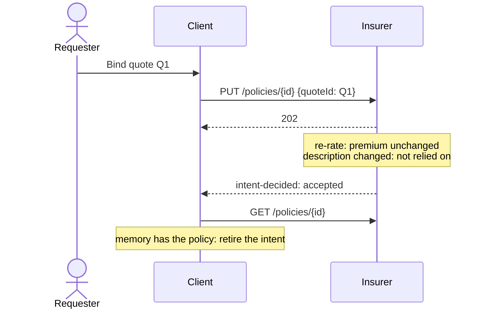
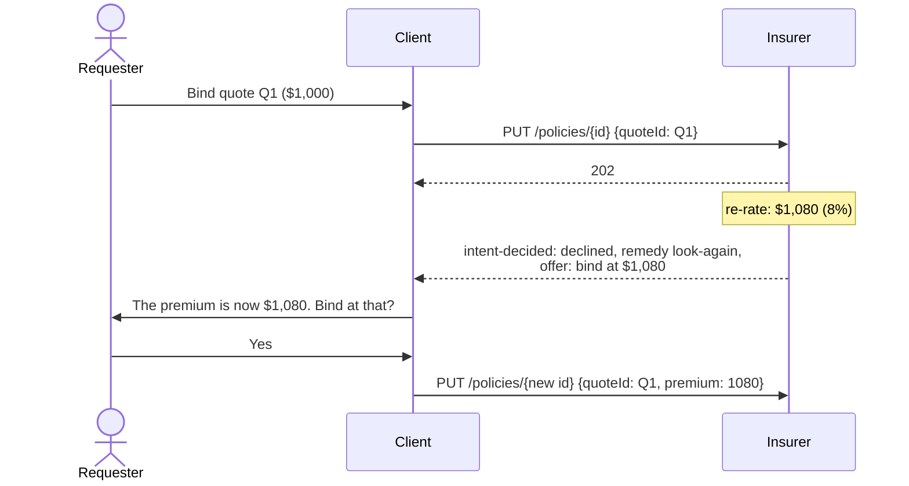
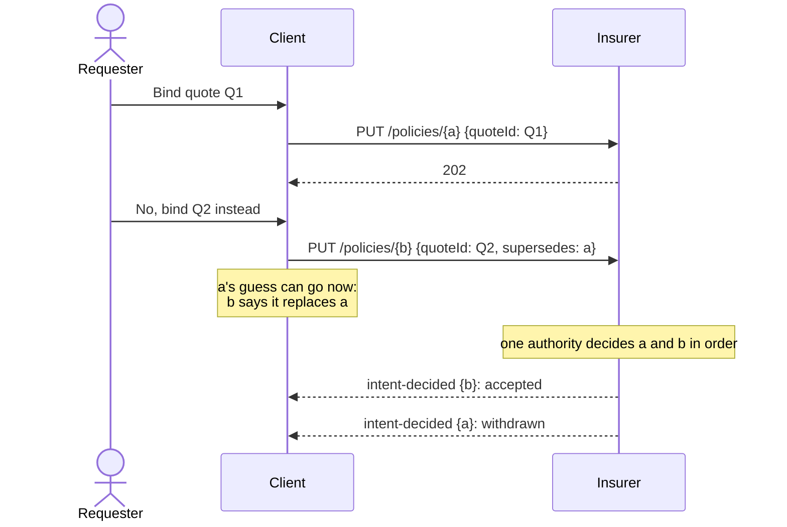

# A second domain: quote → bind

**Since then:** rewritten as errands in [errands-insurance.md](errands-insurance.md#bind-a-quote),
which drops `supersedes` (withdraw, then ask again) and reads "accepted on terms" as
plain accepted (they got what they asked for, or better). Read that first; this is the
earlier attempt.

**2026-10-24. Spec only; nothing is built.** Holds barely has a basis: who's asking, and
a count. This domain's intent rests on a price, which can change underneath it
materially or not. Written in the [IRMTO form](specifying-intents.md) before any code,
with **roles** instead of people, to see whether that reads better.

The business answers are **invented**, to show the shape. They aren't any insurer's.

## The cast

An actor here is a **role** in the staging of one intent, not an identity. Who plays it is
decided per intent (the *casting*).

| Role          | Who can be cast                          | Cast by                       |
| ------------- | ---------------------------------------- | ----------------------------- |
| **Requester** | the customer, or an agent acting for them | the session                   |
| **Customer**  | the person whose policy it will be       | the quote (it names them)     |
| **Insurer**   | the rating and binding service           | always                        |
| **Underwriter** | a person on the insurer's staff        | the insurer, when it escalates |

When the requester is the customer, two roles share one person. When it's an agent, they
don't, and that's all "on behalf of" means.

## Bind a quote

- **Intent:** Requester → Insurer: bind quote {Q} for {Customer}.
  `PUT /policies/{intentId}`, body `{ quoteId }`. A create: the intent's id is the
  policy's.
- **Rests on:**
  - the session casts the requester. The requester may act for the customer (it's them,
    or their agent).
  - **the facts the customer relied on**, from quote Q: the premium, the coverage, and
    the vehicle. **Not** the quote's description, which can be corrected without anyone
    relying on it.
  - the quote is unexpired (30 days).
- **Manifests when:**
  - the premium, re-rated now, is within 2% or $25 of the quoted one;
  - the vehicle still isn't reported stolen or totalled;
  - the quote isn't already bound, or superseded.
- **Then:** a policy is bound at the **quoted** premium. **Tell:** the customer (the
  person, durably), and the requester if that's someone else.
- **Otherwise:**
  - **The premium moved more than that** → declined, remedy `look-again`. **Insurer →
    Customer:** here's the new premium; bind at that? (Their yes is a new intent.)
  - **The premium moved less than that** → accepted on terms: bound at the quoted
    premium, and the record says the difference was waived.
  - **Only the description changed** → accepted. Nothing they relied on moved.
  - **The quote expired** → `still-want-it` if re-rating gives the same premium (same
    id, after they confirm), otherwise `look-again`.
  - **The vehicle was reported stolen or totalled** → declined, remedy `no`. **Insurer →
    Customer:** talk to an agent?
  - **They bind a revised quote first** (another intent that supersedes this one) →
    withdrawn. **Tell:** this browser, quietly.
  - **Nobody decides within an hour** (the decision keeps failing) → **Insurer →
    Underwriter:** decide this binding, caused by this intent. **Tell:** the customer,
    "an underwriter is looking at it." Not final.
  - signed out → `sign-in`, same id. The same id with another body → declined (409).

## Bind a revised quote instead

- **Intent:** Requester → Insurer: bind quote {Q2} for {Customer}, **superseding** the
  binding of {Q1}. A new intent, with a new id, that names the one it replaces.
- **Rests on:** as above, for Q2, plus: the binding of Q1 is still undecided.
- **Then:** Q2 is bound, and the Q1 binding is withdrawn.
- **Otherwise:**
  - **The Q1 binding was decided first** → this one is decided on its own merits: two
    policies would be wrong, so → declined, remedy `look-again` ("You already have a
    policy from quote Q1"). The business could choose differently (replace the policy);
    this is where it says so.

This is the semi-real example of `withdrawn`, and the first use of `supersedes`.

## The three stories

**Bound, with nothing material changed** (the description was corrected in between):

**The premium moved materially:**

**Superseded before it was decided:**

## What this should test, written before building

Predictions, so they can be wrong:

1. **The wire can't say `look-again` yet.** A declined outcome carries remedy `no` and
   nothing else. This needs the remedy, and an offer, on the wire.
2. **An ETag on the quote is the wrong basis.** The description and the premium are in
   one resource, so a correction would look like a change. The basis has to name facts
   (the premium, the vehicle's status), which is what DCB's tags do on the server.
3. **"Accepted on terms" needs no new outcome.** It's accepted, and the record says what
   was waived. If the client has to show it differently, this is wrong.
4. **`supersedes` lets the client drop the old guess at once**, with no app code, unlike
   the holds demo.
5. **The remedy principle's two owners hold up**: the client never decides whether the
   premium is still acceptable; it only delivers, and the insurer answers.
6. **The race between a and b needs one authority**, deciding both in order (the
   customer's bindings). That's the "unique choice" case from the Complete CALM paper,
   and on the server it's a DCB tag on the customer.

What it doesn't test: anything about the edge, or receipts by phase.
